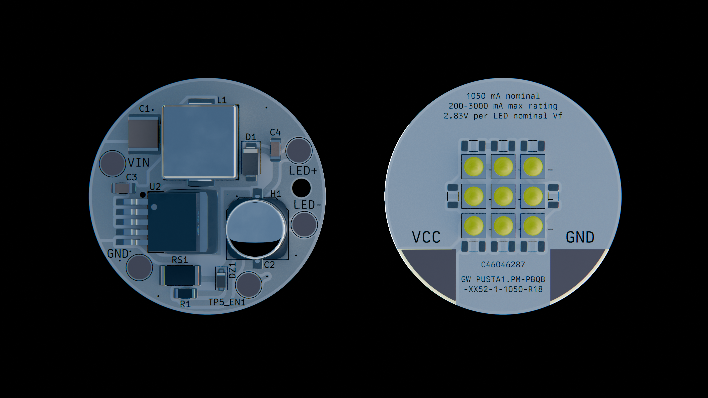
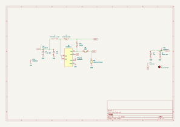
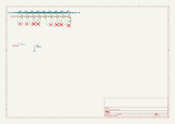
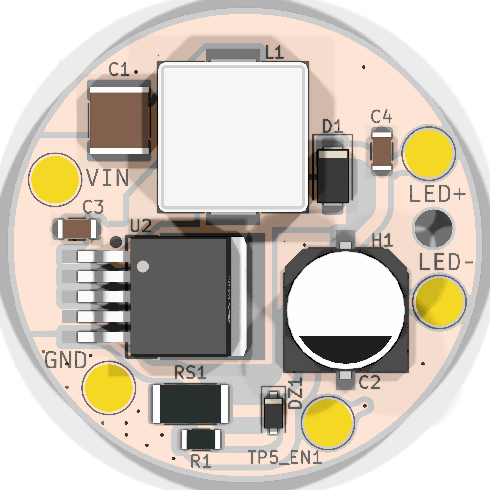
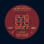
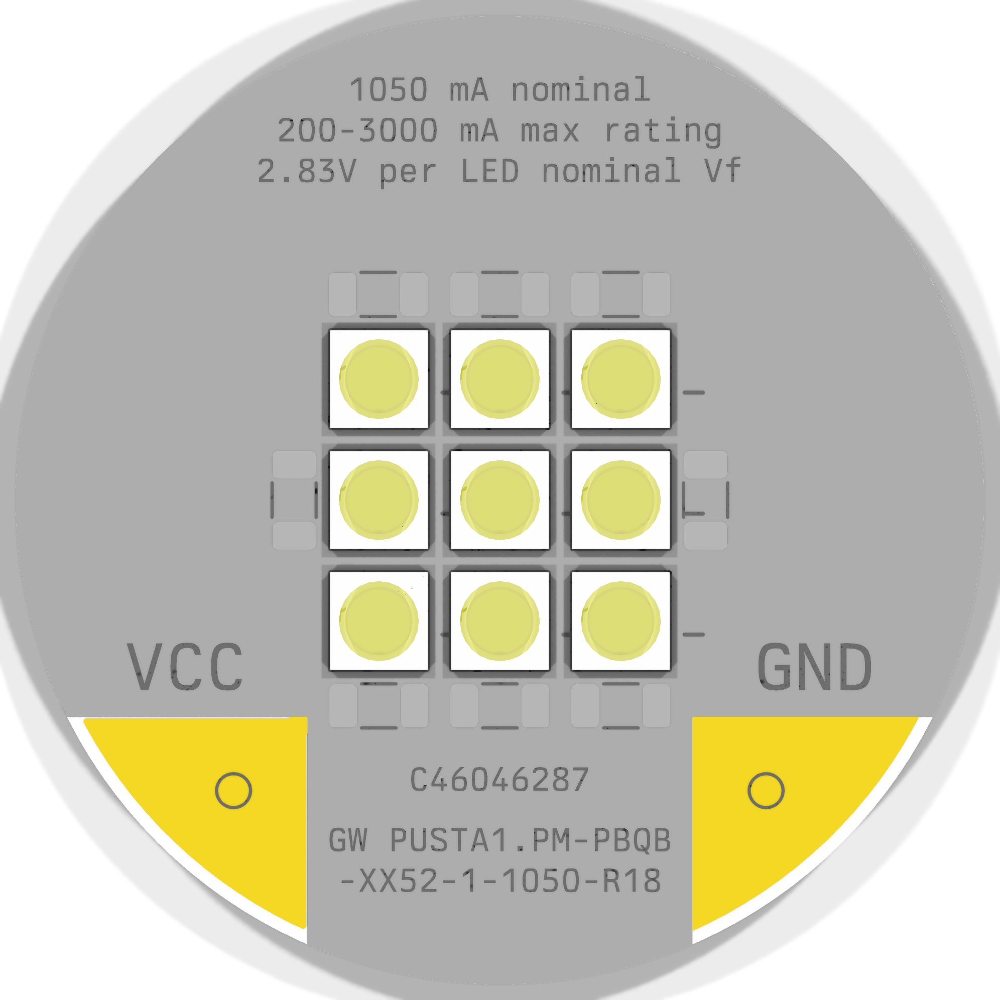

# flsh

A flashlight with the brightness of 83 iphones.

Some features:
 - 9x OSRAM GW PUSTA1.PM-PBQB-XX52-1-1050-R18 for ~5000 lm nominal.
 - XL6006 driver board designed to boost a 2x21700 pack up to the required 28v@1.1A

I made this because I thought it would be pretty cool. Also I got to think about designing power circuitry. I looked at a lot of different ICs before settling on the XL6006. In the end, TI and Analog both were beaten out by Shanghai Xinlong Semiconductor Technology Co., Ltd, so there you go! While the XL6006 gets a bad rap on cheap aliexpress boost boards, the chip itself will work fine if you have a good inductor etc. And it only requires like five passives to work! I evaluated a lot of different designs, see [planning](planning/). 

In terms of the LEDs, I pretty much went on to LCSC and clicked "sort high to low" on lumens. But really, I thought this was more reasonable than most CoB solutions. 

You might be wondering why they are in series. This is to prevent thermal runaway, where one LED uses slightly more current, which causes it to get hotter, which causes it to hog current slightly more, etc in a positive feedback loop. You can use ballast resistors. I just wired them in parallel and accepted the steep boost ratio.

PWM dimming? hahaha you can source and solder a different sense resistor to get a different brightness.

## How to use?

2x21700 to `VIN` / `GND` on the boost board, then `LED+` / `LED-` on the boost board to `VCC` / `GND` on the emitter board.

As you can tell, this is, for the moment, mostly the bones of a flashlight (ie the PCBs) rather than an actual assembly. 

## Schematics

### flsh boost

[View on KiCanvas](https://kicanvas.org/?repo=https%3A%2F%2Fgithub.com%2FJBlitzar%2Fflsh%2Ftree%2Fmain%2FPCB%2Fflsh)

### flsh led

[View on KiCanvas](https://kicanvas.org/?repo=https%3A%2F%2Fgithub.com%2FJBlitzar%2Fflsh%2Ftree%2Fmain%2FPCB%2Fflsh)

## PCBs

### flsh boost

[View on KiCanvas](https://kicanvas.org/?repo=https%3A%2F%2Fgithub.com%2FJBlitzar%2Fflsh%2Ftree%2Fmain%2FPCB%2Fflsh) | [View iBOM](https://htmlpreview.github.io/?https://github.com/JBlitzar/flsh/blob/main/PCB/flsh/bom/ibom.html) (or open `PCB/flsh/bom/ibom.html` locally)

### flsh led

[View on KiCanvas](https://kicanvas.org/?repo=https%3A%2F%2Fgithub.com%2FJBlitzar%2Fflsh%2Ftree%2Fmain%2FPCB%2Fflsh)

## About cost

This is a ballpark, YMMV based on sourcing, promotions, discounts

## Overall BOM

|Item            |Link                                              |Extended Cost|Notes                                      |
|----------------|--------------------------------------------------|-------------|-------------------------------------------|
|10x LEDs (MOQ)  |https://www.lcsc.com/product-detail/C46046287.html|17.15        |                                           |
|LED PCB         |N/A                                               |2.44         |                                           |
|Boost components|N/A                                               |18           |See fabrication BOM in README for C-numbers|
|LCSC shipping   |N/A                                               |8            |                                           |
|JLC shipping    |N/A                                               |3.3          |                                           |
|                |                                                  |             |                                           |
|Total           |                                                  |48.89        |                                           |

## Fabrication BOMs

### flsh boost

| Designator | Footprint | Quantity | Value | LCSC Part # |
| --- | --- | --- | --- | --- |
| C1 | C_2220_5750Metric | 1 | 47uF 35V | C27840590 |
| C2 | CAP-SMD_BD10.0-L10.3-W10.3-FD | 1 | 100uF 63V | C53120969 |
| C3, C4 | C_1206_3216Metric | 2 | 1uF | C13832 |
| D1 | D_SMA | 1 | SS38 | C64999 |
| DZ1 | D_SOD-123F | 1 | ZENER (BZT52C39, 39V) | C49023525 |
| H1 | MountingHole_3.2mm_M3 | 1 | MountingHole |  |
| L1 | IND-SMD_L13.8-W12.6_H6.5 | 1 | YSPI1365-470M (47uH) | C497913 |
| R1 | R_1206_3216Metric | 1 | 2k | C133543 |
| RS1 | R_2512_6332Metric | 1 | JER2512F2R220 (0.22R) | C49164922 |
| TP1, TP2, TP3, TP4, TP5_EN1 | TestPoint_Pad_D4.0mm | 5 | TestPoint |  |
| U2 | TO-263-5_L10.2-W9.9-P1.70-LS14.4-TL | 1 | XL6006E1 | C73346 |

### flsh led

| Designator | Footprint | Quantity | Value | LCSC Part # |
| --- | --- | --- | --- | --- |
| C1, C2, C3, C4, C5, C6, C7, C8 | C_1206_3216Metric | 8 | C_US (DNP) |  |
| LED1, LED2, LED3, LED4, LED5, LED6, LED7, LED8, LED9 | LED-SMD_3P-L3.7-W3.7_GW-PUSTA1.PM-NAPD-XX510-1-1050-R18 | 9 | GW PUSTA1.PM-PBQB-XX52-1-1050-R18 | C46046287 |
| TP1, TP2 | TestPoint_Pad_D1.0mm | 2 | TestPoint |  |
